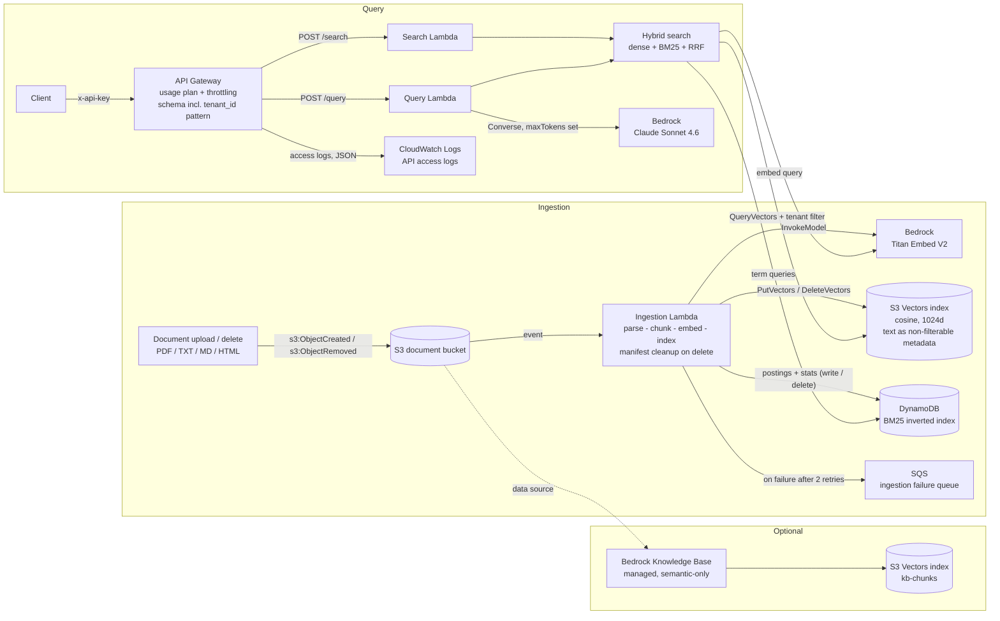
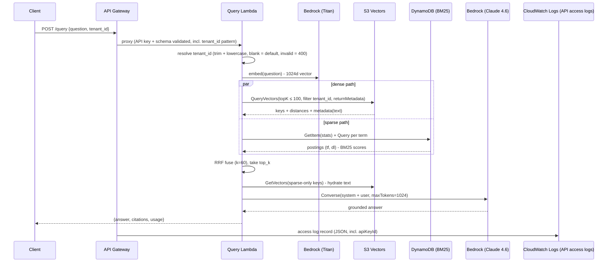
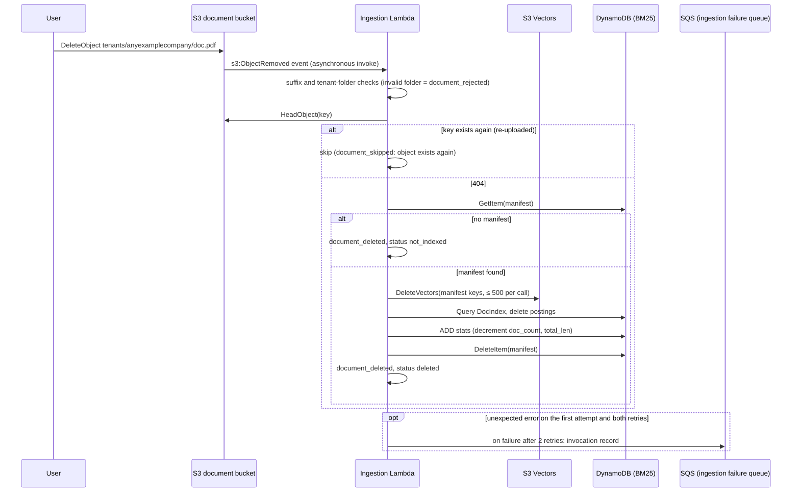
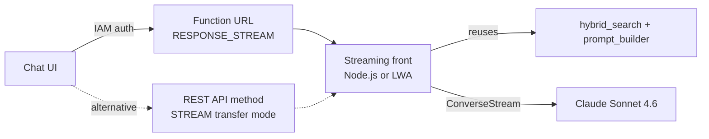

# Architecture

Hybrid-search RAG on Amazon S3 Vectors. All components are
serverless and scale to zero.

![Architecture diagram showing the query flow (Amazon API Gateway to the Search and Query AWS Lambda functions, which embed the query with Amazon Titan Text Embeddings V2, run dense search on S3 Vectors and BM25 on Amazon DynamoDB, fuse with RRF, and call Claude through Converse), the ingestion and delete flow (S3 ObjectCreated and ObjectRemoved events to the ingestion function, which writes or removes vectors and BM25 postings and sends events that fail every retry to an Amazon SQS failure queue), Amazon CloudWatch Logs including the API access logs, and the optional Amazon Bedrock Knowledge Bases stack](architecture.png)

Editable source: [architecture.drawio](architecture.drawio) - open with
[draw.io / diagrams.net](https://app.diagrams.net/) or the VS Code Draw.io
extension; [architecture.png](architecture.png) is the rendered export used
for the APG attachment. Re-export it whenever the .drawio file changes.

## System overview

## Query sequence

## Ingestion and delete propagation

One ingestion function handles both S3 event types (`s3:ObjectCreated` and
`s3:ObjectRemoved`). Ingestion triggers on `.pdf .txt .md .markdown .html .htm`
in all-lowercase or all-uppercase form (for example, `.pdf` or `.PDF`); S3
suffix filters are case-sensitive, so mixed-case suffixes such as `.Pdf`
don't trigger ingestion. The tenant comes from the key: `tenants/<tenant_id>/...` is
lowercased and must match `^[a-z0-9][a-z0-9_-]{0,63}$`, otherwise the object
is rejected (`document_rejected` log record, nothing indexed); keys outside
`tenants/<folder>/` belong to the default tenant.

Deleting a document from the bucket invokes the ingestion function through an
`s3:ObjectRemoved` notification, which uses the document's manifest to delete
its vectors and BM25 postings and decrement the tenant statistics
(`document_deleted` log record). Because S3 doesn't guarantee event order,
the function first checks whether the key exists again; if it was re-uploaded
after the delete, the cleanup is skipped so that a late delete event can't
wipe the newer upload.

Unexpected errors are logged (`ingestion_failed`) and re-raised so that
AWS Lambda retries the asynchronous event (two more attempts by default).
Events that fail every retry go to the ingestion function's on-failure
destination, an Amazon SQS queue (stack output `IngestionFailureQueueUrl`,
14-day retention), instead of being dropped.
Outcomes a retry can't change (unsupported format, invalid tenant folder, no
extractable text, object no longer exists) return without raising. Retries
converge because every write is keyed by the document; the residual effects
of a partial failure (tenant statistics applied twice, orphaned chunks if the
object is overwritten between attempts) are described in the pattern's
*Index design notes for BM25 on DynamoDB*.

## Component responsibilities

| Component | Responsibility | Key decisions |
| --- | --- | --- |
| S3 Vectors index | Dense ANN + system of record for chunk text | cosine / float32 / 1024d; `text` non-filterable; ENHANCED (default for vector buckets created on or after September 30, 2026) pre-filters; CLASSIC filters during the search and can return fewer than top-k; dense requests capped at 100 candidates (the QueryVectors page size) |
| Amazon DynamoDB table | BM25 postings, tenant stats, doc manifests | On-demand; postings `T#<tenant>#TERM#<term>` with denormalized `dl`; df derived at read time; stats via atomic `ADD`; per-term reads capped at 5,000; `DocIndex` GSI for re-ingest and delete cleanup |
| Ingestion Lambda | Parse, chunk (~512 tok / 12.5% overlap), embed, index both paths; remove both on delete | Idempotent re-ingest via manifest (delete old vectors + postings first); `s3:ObjectRemoved` reuses the manifest cleanup (skipped if the key exists again); rejects uploads under an invalid `tenants/<folder>/`; unexpected errors re-raised so Lambda retries |
| Search Lambda | `/search`: retrieval only | Modes: hybrid / dense / sparse for A-B comparison; `tenant_id` must match `^[a-z0-9][a-z0-9_-]{0,63}$` after trimming and lowercasing; blank or omitted means the default tenant |
| Query Lambda | `/query`: retrieval + generation | Hybrid search runs in-process (no Lambda hop); token-budgeted prompt; citations mirror packed passages; same `tenant_id` rule as `/search` |
| Ingestion failure queue (Amazon SQS) | On-failure destination of the ingestion function (compute stack): receives the event after the asynchronous retries (two by default) are exhausted | SQS-managed encryption, SSL enforced, 14-day retention; URL exported as `IngestionFailureQueueUrl` |
| Amazon API Gateway | API keys for usage-plan metering (not authentication), JSON Schema validation including the `tenant_id` pattern, throttling | Schema pattern also accepts blank and mixed-case values, which the handlers normalize; usage plan (10 rps / 20 burst / 50k month by default) |
| Amazon CloudWatch Logs | Three function log groups (compute stack) and the API access log group `ApiAccessLogs` (API stack), 14-day retention | Generated function log group names exported as `IngestionLogGroupName`, `SearchLogGroupName`, `QueryLogGroupName`; API access logs in a custom JSON format that includes the API key ID, delivered through the account-level API Gateway CloudWatch Logs role (retained on stack delete) |

## Multi-tenant isolation

Both retrieval paths enforce the tenant on the storage side, not only in
application code:

- Dense: every vector carries `tenant_id` filterable metadata; every query
  passes `filter={"tenant_id": {"$eq": tenant}}` into `QueryVectors`.
  `dense_search()` refuses to run without a tenant, so no code path can
  query every tenant's vectors.
- Sparse: DynamoDB partition keys embed the tenant
  (`T#anyexamplecompany#TERM#invoice`), so another tenant's postings are physically
  unreachable by key construction.

Tenant IDs are validated before either path runs. `/search` and `/query`
trim and lowercase `tenant_id`. An omitted, empty, or whitespace-only value
resolves to the default tenant, and the API rejects any other value that doesn't match
`^[a-z0-9][a-z0-9_-]{0,63}$` with HTTP 400. The API's JSON Schema
pattern rejects the same values at the edge. The ingestion function doesn't ingest an upload under a
`tenants/<tenant_id>/` folder whose name doesn't match the same pattern after
lowercasing; it logs a
`document_rejected` record.

The `tenant_id` currently arrives in the request payload (trusted-caller
model). For untrusted clients, derive it from an authorizer (for example, an
Amazon Cognito user pool claim or a tenant value that a Lambda authorizer
returns in the request context) instead of the request payload. The
resolution happens in exactly one place in each handler
(`resolve_request_tenant()` in `src/common/tenant.py`), so the swap is a
small change.

## Streaming: the honest version

Verified constraints (both retrieved October 12, 2026):

- Lambda supports response streaming only on Node.js managed runtimes;
  Python functions need a custom runtime or the AWS Lambda Web Adapter
  ([Lambda response streaming](https://docs.aws.amazon.com/lambda/latest/dg/configuration-response-streaming.html)).
- API Gateway REST APIs buffer integration responses by default; since
  November 19, 2025 they also support the STREAM response transfer mode for
  proxy integrations (`HTTP_PROXY` and `AWS_PROXY`), but the integrated
  function must stream
  ([API Gateway response transfer mode](https://docs.aws.amazon.com/apigateway/latest/developerguide/response-transfer-mode.html)).

So the Python `/query` function returns buffered JSON (which is what
backend-to-backend callers want anyway). For chat-style token streaming, the
supported wiring is:

1. Keep this stack unchanged.
2. Add a Lambda **Function URL** with `invoke_mode=RESPONSE_STREAM` on a thin
   streaming front: either a small Node.js handler that calls Bedrock
   `ConverseStream` directly, or the Python code behind the
   [AWS Lambda Web Adapter](https://github.com/awslabs/aws-lambda-web-adapter)
   (custom-runtime wrapper that enables streaming for Python web apps).
3. The retrieval + prompt logic is already reusable: the query Lambda exposes
   `stream_answer()` (a `ConverseStream` generator) in
   `src/query/handler.py` for exactly this purpose.

As an alternative to the Function URL in step 2, a REST API method in STREAM
response transfer mode (a proxy integration) can front the same
streaming-capable function.

## Design decisions log

| # | Decision | Rationale |
| --- | --- | --- |
| 1 | Chunk text lives in S3 Vectors non-filterable metadata | Dense results return passages for free (`returnMetadata`); no second store to keep consistent; DynamoDB stays small |
| 2 | df computed from postings at query time | One less counter to drift; a term query already reads its postings |
| 3 | Query Lambda runs hybrid search in-process | Saves a Lambda hop (latency + double billing); code shared via one bundled asset |
| 4 | RRF (k=60) over score blending | Rank-only fusion needs no calibration between cosine and BM25 scales |
| 5 | Converse API, explicit `maxTokens`, adaptive retries | When `maxTokens` is omitted it defaults to the model's maximum output, and Amazon Bedrock reserves input tokens plus `maxTokens` against the tokens-per-minute and tokens-per-day quotas until the request finishes; oversized reservations are a common cause of unexpected `ThrottlingException` errors |
| 6 | Cross-Region inference profile (`us.`) | Per-Region on-demand quotas; routing across 3 US Regions cuts throttling; some newer models are profile-only |
| 7 | No assistant prefill in prompts | Claude Sonnet 4.6 and later models reject a prefilled final assistant turn with a 400 error |
| 8 | Amazon Bedrock Knowledge Bases stack optional, off by default | Duplicate embedding/storage cost; KB on S3 Vectors is semantic-only; Amazon Titan Text Embeddings V2 is available by default, so no model-access step is needed |
| 9 | Bedrock KB not used for the primary path | Hybrid search unsupported on S3 Vectors KBs - the core of this pattern |
| 10 | BM25 stats via atomic `ADD`; df never stored | No per-term counter to drift; concurrent ingests of different documents cannot lose updates. Residual race: simultaneous same-key uploads can skew score scaling only - hardening path documented in the pattern's design notes |
| 11 | Posting reads capped at 5,000 per term | Very common terms carry near-zero idf but unbounded read cost; stopwords + the cap bound hot-partition reads on `T#<tenant>#TERM#<term>` |
| 12 | Deletes propagate through `s3:ObjectRemoved` | Manifest-driven cleanup removes vectors, postings, and the stats contribution; a delete event for a key that exists again (re-uploaded) is skipped so a late event can't wipe the newer upload |
| 13 | Tenant IDs validated at the API edge and in the handlers; dense path always filtered | A blank `tenant_id` resolves to the default tenant instead of removing the filter; invalid IDs get 400; `dense_search()` refuses to run without a tenant; uploads under an invalid tenant folder are rejected |
| 14 | Unexpected ingestion errors re-raised | Lambda's asynchronous retries apply and converge because writes are keyed by document; residual: a retried partial failure can apply the tenant stats change twice (BM25 scaling only) |
| 15 | Log groups keep generated names, exported as stack outputs | No hard-coded log group names; runbooks and the smoke test read `IngestionLogGroupName`, `SearchLogGroupName`, `QueryLogGroupName` |
