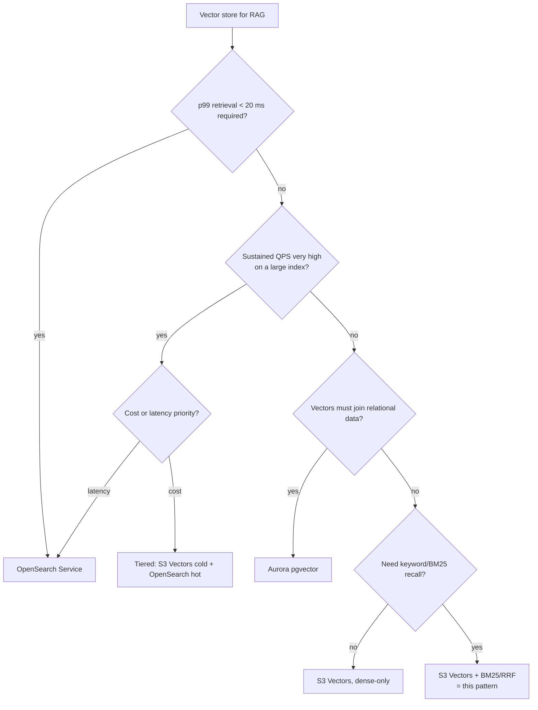

# Cost comparison and decision framework

S3 Vectors vs. Amazon OpenSearch Serverless vs. Amazon Aurora PostgreSQL
(pgvector) for RAG vector storage.

> Prices are us-east-1 list prices retrieved October 12, 2026, from the
> [Amazon S3 pricing page](https://aws.amazon.com/s3/pricing/) (Vectors tab),
> [Amazon OpenSearch Service pricing](https://aws.amazon.com/opensearch-service/pricing/),
> [Amazon Aurora pricing](https://aws.amazon.com/rds/aurora/pricing/),
> [Amazon Bedrock pricing](https://aws.amazon.com/bedrock/pricing/), and the
> AWS Price List files for
> [Amazon DynamoDB](https://pricing.us-east-1.amazonaws.com/offers/v1.0/aws/AmazonDynamoDB/current/us-east-1/index.json),
> [AWS Lambda](https://pricing.us-east-1.amazonaws.com/offers/v1.0/aws/AWSLambda/current/us-east-1/index.json), and
> [Amazon API Gateway](https://pricing.us-east-1.amazonaws.com/offers/v1.0/aws/AmazonApiGateway/current/us-east-1/index.json).
> Always confirm current rates before making decisions - pricing changes
> without notice.

## Pricing models at a glance

| | **S3 Vectors** | **OpenSearch Serverless** | **Aurora Serverless v2 + pgvector** |
| --- | --- | --- | --- |
| Billing unit | Pure pay-per-use | OCU-hours ($0.24/OCU-hour); classic collections always on, NextGen scales to zero | Aurora Capacity Units (ACU-hours) + storage + I/O |
| Storage | $0.06 / GB-month (vector data + keys + metadata) | $0.024/GB-month (classic managed storage; NextGen hot storage $0.30/GB-month) + OCUs | $0.10 / GB-month + I/O |
| Write | $0.20/GB uploaded, minimum 128 KB billed per PutVectors call | included in OCUs | included in ACUs / I/O |
| Query | $0.0025 per 1,000 QueryVectors requests + data processed ($0.004/TB for the first 100k vectors per index, $0.002/TB beyond, counted on vector + key + filterable metadata); GetVectors and other requests $0.055 per 1,000 | included in OCUs | included in ACUs |
| Practical floor | $0 compute; storage still bills | about $350/month minimum for a classic collection with high availability (2 OCU), or about $175/month for dev-test without standby (1 OCU); NextGen collections scale to zero after 10 idle minutes, with a 10-30 second cold start | about $44/month at the 0.5 ACU minimum when kept warm; auto-pause to 0 ACU with about a 15-second-or-longer resume |
| Typical ANN latency | subsecond for infrequent queries, as low as 100 ms for more frequent queries ([Working with S3 Vectors and vector buckets](https://docs.aws.amazon.com/AmazonS3/latest/userguide/s3-vectors.html)) | AWS positions OpenSearch Serverless for high-QPS, low-latency vector search ([same page](https://docs.aws.amazon.com/AmazonS3/latest/userguide/s3-vectors.html)); measure on your workload | not quantified here; measure on your workload |
| Native hybrid (BM25) | No - this pattern adds BM25+RRF via DynamoDB | Yes (built-in) | Partial (`tsvector` + manual fusion) |
| Max practical scale | 2 B vectors/index, 10 k indexes/bucket | very large (OCU scaling) | limited by instance/ACU sizing |
| Amazon Bedrock Knowledge Bases support | Yes (semantic-only, no hybrid) | Yes (incl. hybrid) | Yes (incl. hybrid) |

## Worked examples (1,024-dim float32: about 6.4 KB stored per vector including key, metadata, and chunk text; about 4.3 KB counted for query data processing)

Each vector carries 4,096 B of float32 data, about 40 B of key, about 200 B
of filterable metadata, and up to 2,048 B of chunk text as non-filterable
metadata. Storage counts all of it (about 6,384 B); query data processing
excludes non-filterable metadata (about 4,336 B). Query results stay within
the per-query free data-returned allowance at these result sizes.

### Scenario A - small knowledge base: 100k chunks, 50k queries/month

| Cost item | S3 Vectors | OpenSearch Serverless | Aurora Sv2 |
| --- | --- | --- | --- |
| Storage (~0.6 GB) | 0.6 x $0.06 ≈ **$0.04** | ~$0.01 + OCUs | ~$0.06 + I/O |
| Ingestion (one-time ~0.6 GB PUT) | **$0.12** | - | - |
| Queries (50k) | $0.125 requests + $0.08 data processing, plus up to $2.75 GetVectors | - | - |
| Compute floor | $0 | about $175 (1 OCU dev-test) or about $350 (2 OCU, HA); NextGen $0 idle | about $44 (0.5 ACU warm) or $0 paused |
| **Monthly total** | **≈ $0.25-3** | **≈ $175-350+** | **≈ $44+ warm** |

S3 Vectors costs more than 98 percent less than an OpenSearch Serverless
classic collection and about 93-99 percent less than a warm Aurora Serverless
v2 instance at this scale. The upper end of the S3 Vectors range assumes one
GetVectors call per query (hybrid results that include keyword-only hits).
DynamoDB (BM25), Lambda, and API Gateway add about $1.5-3/month at this
volume (see the all-in comparison below); Bedrock token costs are identical
across options.

### Scenario B - mid-size: 1M chunks, 500k queries/month

| Cost item | S3 Vectors | OpenSearch Serverless | Aurora Sv2 |
| --- | --- | --- | --- |
| Storage (~6 GB) | **$0.36** | ~$0.14 + OCUs | ~$0.60 + I/O |
| Queries (500k) | $1.25 requests + $4.34 data processing, plus up to $27.50 GetVectors | - | - |
| Compute | $0 | from about $175 or about $350 (classic), rising as OCUs scale with load | about $44-88 (0.5-1 ACU sustained) |
| **Monthly total** | **≈ $6-34** | **≈ $175-350+** | **≈ $45-90** |

About 80-98 percent less than the OpenSearch Serverless classic floor,
depending on how many queries trigger GetVectors. Note the S3 Vectors query
data-processing charge grows with index size × query volume - it is the term
to watch as you scale.

### Scenario C - large + hot: 10M chunks, 10M queries/month

With one index, every query is billed for processing the whole index:
10M vectors × about 4,336 B ≈ 43 GB per query, or about 434 PB per month.
Data processing comes to about $797/month, plus $25 for query requests and
$3.57 for storage: **≈ $825/month**, plus up to $550 for GetVectors if every
query also hydrates keyword-only hits.

S3 Vectors isn't the cheaper option at this scale. OpenSearch Serverless cost
depends on the OCU sizing the load needs (not estimated here; every 2 OCUs
adds about $350/month), and OpenSearch delivers lower query latency with
native hybrid search. Evaluate OpenSearch Serverless or the tiered design
(below).

## Hybrid search vs. hybrid search: all-in sample use case

The scenarios above price the vector store alone. For a fair **hybrid-search**
comparison, this pattern's side must also carry the BM25 machinery (DynamoDB)
and the serving layer (Lambda, API Gateway) - on OpenSearch, all of that is
inside the OCUs. Sample use case: the Scenario A internal knowledge base -
**100k chunks (~512 tokens each), 50k hybrid queries/month, single tenant,
us-east-1 list prices**.

Assumptions for the BM25 side: ~150 unique terms per chunk after stopword
removal (≈ 15M posting items, about 440 B billed each including the DocIndex
GSI copy ≈ 6.1 GiB), ~6 query terms per search reading a few hundred postings
each, ~1.5 s Lambda time per query at 1,024 MB (the query function; ARM64).
Generation (Claude) tokens are identical on both sides and excluded. Query
embedding (Amazon Titan Text Embeddings V2 at $0.02 per million tokens, under
$0.20/month at both the 100k and the 1M scale) is excluded too; an OpenSearch
k-NN alternative needs the same embedding call.

| Cost item (monthly) | This pattern (S3 Vectors + DynamoDB BM25) | OpenSearch Serverless hybrid |
| --- | --- | --- |
| Compute floor | $0 (scales to zero) | about $350/month minimum for a classic collection with high availability (2 OCU), or about $175/month for dev-test without standby (1 OCU); NextGen collections scale to zero after 10 idle minutes, with a 10-30 second cold start |
| Vector storage + queries | ≈ $0.25-3 (Scenario A; upper end includes one GetVectors call per query) | included in OCUs + $0.024/GB-month storage |
| BM25 postings storage | 6.1 GiB × $0.25 ≈ **$1.54** ($0 within the 25 GB free tier) | included (Lucene index inside OCUs) |
| BM25 query reads | 50k × ~27.5 RRU × $0.125/M ≈ **$0.17** | included |
| Lambda (ARM64) | 75k GB-s ≈ **$1.01** | n/a (query through OpenSearch API) |
| API Gateway (REST) | 50k × $3.50/M ≈ **$0.18** | n/a or equivalent front |
| **Monthly total (retrieval path)** | **≈ $2-6** | **from about $175 (dev-test) or $350 (HA); NextGen $0 idle** |
| One-time ingest (corpus) | ≈ $18.75 DynamoDB posting writes (15M postings × 2 WRU for the base table and the DocIndex GSI × $0.625/M) + $1.02 Titan embeddings + $0.12 S3 Vectors PUT ≈ **$20** | ≈ $1 Titan embeddings (indexing compute in OCUs) |

Even charging this pattern for every moving part, the hybrid retrieval path
costs about 97-99 percent less than the OpenSearch Serverless classic floor
at this volume. At Scenario B size (1M chunks, 500k queries/month) the all-in
figure rises to ≈ $35-80/month (the upper end assumes postings read per term
grow with the corpus and one GetVectors call per query) against the same
floor. The one-time DynamoDB ingest write cost (about $19 per 100k chunks) is
the only place the BM25 side is visible, and it amortizes over the corpus
lifetime; re-ingesting or deleting a document deletes its old postings at the
same 2 WRU per posting. DynamoDB unit prices: $0.625 per million WRU, $0.125
per million RRU, $0.25 per GB-month (first 25 GB free); OCU $0.24/hour -
us-east-1, retrieved October 12, 2026.

## When to use which

**Choose S3 Vectors when:**
- Queries are low to moderate in volume. S3 Vectors supports up to 2 billion
  vectors per index
  ([S3 Vectors limitations](https://docs.aws.amazon.com/AmazonS3/latest/userguide/s3-vectors-limitations.html)),
  but this pattern's DynamoDB BM25 sparse path and cost estimates are sized
  for corpora of up to roughly 1 million chunks; for larger corpora, validate
  sparse-path read cost and latency on your data, or use dense-only retrieval.
- Subsecond retrieval latency (as low as 100 ms for more frequent queries,
  per [Working with S3 Vectors and vector buckets](https://docs.aws.amazon.com/AmazonS3/latest/userguide/s3-vectors.html)) is acceptable
- Cost floor matters: dev/test environments, many small tenants, archival or
  long-tail corpora
- You can bring your own hybrid search (this pattern) or dense-only is enough

**Choose OpenSearch (Serverless or managed) when:**
- Sustained high QPS where per-query data-processing charges exceed OCU costs
- Single-digit-millisecond latency requirements (search-as-you-type, online
  ranking)
- You need native hybrid/BM25, aggregations, faceting, analyzers out of the box
- You want Amazon Bedrock Knowledge Bases with managed hybrid search
  (supported on OpenSearch Serverless, not on OpenSearch Service managed
  domains)

**Choose Aurora PostgreSQL-Compatible with pgvector when:**
- Your application is already on PostgreSQL and vectors must join with
  relational data transactionally
- Moderate scale, with existing Aurora capacity to amortize
- You want Amazon Bedrock Knowledge Bases hybrid search on a PostgreSQL vector
  store (supported for Aurora PostgreSQL-Compatible)

**Tiered pattern:** keep the full corpus in S3 Vectors (cheap, durable) and
cache hot vectors/collections in OpenSearch for latency-critical tenants -
AWS explicitly positions S3 Vectors for this cold/warm tier with OpenSearch
as the hot tier.

## Decision tree

## This pattern's non-vector costs (typically dollars/month)

| Component | Driver | Note |
| --- | --- | --- |
| Bedrock Titan Embed V2 | $0.02 per million input tokens at ingest + 1 query embedding per search | dominated by initial corpus embedding |
| Bedrock Claude Sonnet 4.6 | input/output tokens per answer | the dominant cost of the whole system at scale; Claude Haiku 4.5 costs one-third as much per token |
| DynamoDB on-demand | BM25 postings writes at ingest (and deletes on re-ingest or document deletion), term reads per query | ~1 read-heavy Query per query term |
| Lambda (ARM64) | ingest seconds + ~1-2 s per query | pennies until high QPS |
| API Gateway | $ per million requests | usage plan caps runaway spend |
